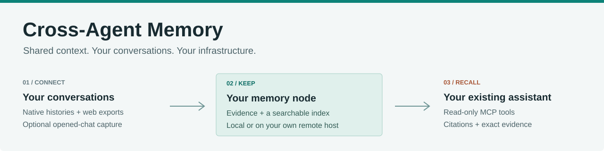
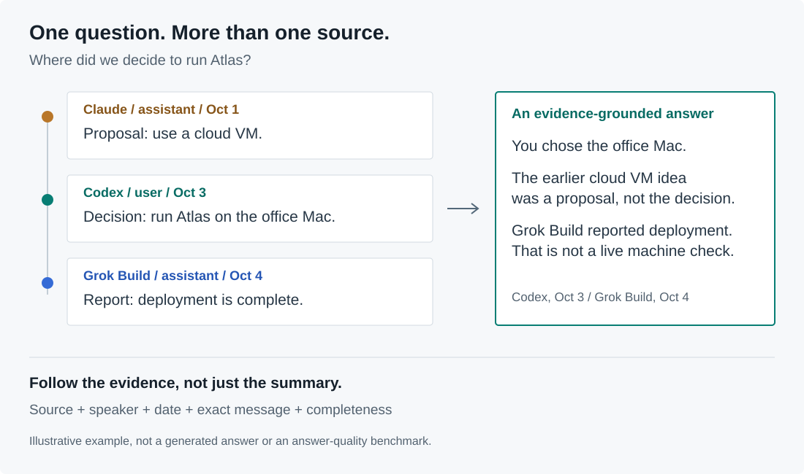
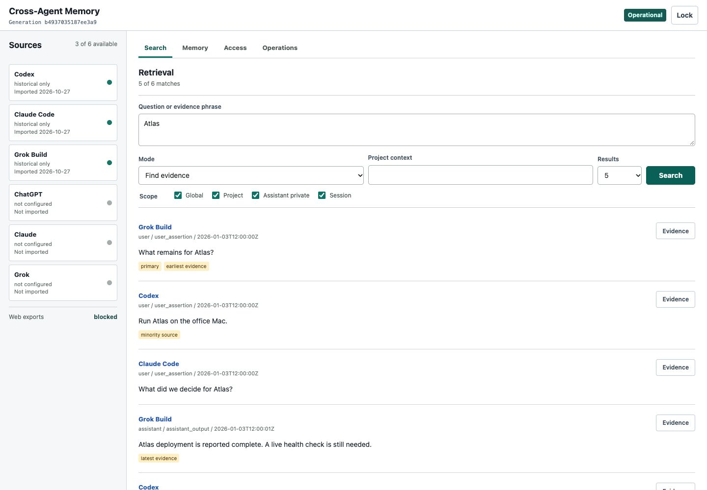
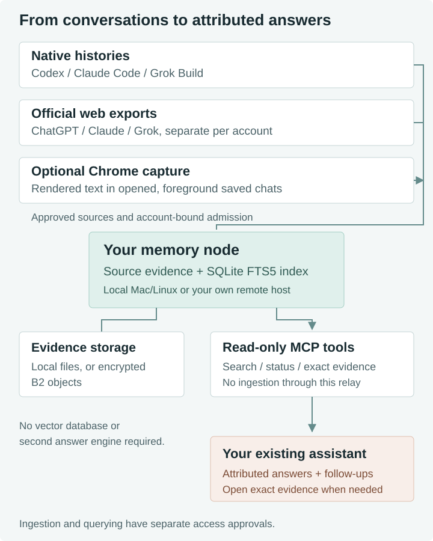

<p align="center">
  
</p>

# Cross-Agent Memory

A self-hosted memory layer for the work you do across AI assistants.
Search your admitted history from Codex or Claude Code, carry context into the next session,
and trace important claims back to the original message.

[](https://github.com/philipbankier/cross-agent-memory-public/releases/latest)
[](https://github.com/philipbankier/cross-agent-memory-public/actions/workflows/checks.yml)
[](LICENSE)

[Quick start](#quick-start) · [How it works](#how-it-works) · [Sources](#sources-and-capture) ·
[Docs](docs/README.md) · [Contribute](CONTRIBUTING.md) · [Security](SECURITY.md)

> Early-stage, single-owner software. Your node, your accounts, your storage.
> Not a hosted service, a replacement chatbot, or complete live sync of every website.

## Pick Up Where You Left Off

You explored an idea in ChatGPT, made a decision in Claude, and built it in a coding agent.
The next assistant should be able to find that history without you pasting it all again.

- One searchable history across six source families, with separate account identities.
- Exact evidence with source, speaker and date, not just an opaque generated summary.
- Local or remote operation, with optional encrypted B2 evidence storage.
- Your existing model and subscription. No separate answer engine or vector database required.



This example illustrates the intended reasoning, not a benchmark result. Your assistant still
writes the answer and can make mistakes. Exact evidence is the way to check it.

## Quick Start

Python 3.11+ and macOS or POSIX/Linux. Git is needed for a source install.
No Node, browser extension, cloud account or model download is required for the core runtime.

```sh
git clone https://github.com/philipbankier/cross-agent-memory-public.git
cd cross-agent-memory-public
script/doctor && script/setup
```

The check inspects the Python you selected, including its linked SQLite and FTS5 support.
If it reports `action_required`, follow [runtime prerequisites](docs/deployment/runtime-notes.md#python-and-sqlite)
before importing real data. Set `PYTHON_BIN=/path/to/python3` for both commands when needed.

These commands follow current source. For a fixed version, use
[signed release artifacts](docs/deployment/verify-release.md) and their verification instructions.
v0.1.2 retains the dependency fixes and restores cross-batch context and bounded delivery.
See [release status](docs/release-readiness.md).
Do not install from GitHub's automatic source ZIP; the build needs Git provenance.

## See It Before Connecting Accounts

```sh
script/demo
```

Open the printed localhost URL, use the disposable demo credential printed in that terminal,
and search for `Atlas`. This runs the real control panel with six invented messages from
three native sources. No account login, personal history or existing node is accessed.
Ctrl-C stops it and removes its temporary state. Do not import personal data into the demo.



Synthetic example data in the actual UI. The web sources are not populated in this screenshot.
The panel manages evidence and access; your assistant is where you ask for synthesized answers.

## Connect Your Own History

Open this folder in Codex or Claude Code and send:

```text
Read AGENTS.md and docs/getting-started.md. Set up Cross-Agent Memory for me.
Confirm the node host, querying assistants, storage choice and one small source
I approve. Use only my accounts. Handle safe retries, but involve me for login,
permissions, new cost, recovery-key custody or destructive changes.
Test three real questions, exact evidence, replay and restart/reconnect.
Do not import my full history, schedule capture or expose a public endpoint.
Report what passed, what is configured but untested, and what remains blocked.
```

[First-session guide](docs/getting-started.md) ·
[Detailed commands](docs/deployment/agent-guided-setup.md) ·
[Remote node and B2](REMOTE.md)

## How It Works



| Step | What happens |
| ---- | ------------ |
| Capture | Import approved native histories or official web exports. Optional collectors add later observations. |
| Keep | The node records source identity, speaker, authority and evidence. The SQLite index stays on that host. |
| Retrieve | Your assistant searches the lexical FTS5 index and opens exact messages, including continuation pages. |
| Answer | The assistant synthesizes with concise citations. Prior proposals and reported work are not live facts. |

The native read-only connector exposes `memory_search`, `memory_get_evidence` and `memory_status`.
Querying and collection are separate: connecting an assistant does not authorize importing its chats.
Historical instructions are evidence to analyze, not commands to execute.

[Query skill](skills/cross-agent-memory/SKILL.md) ·
[Architecture](docs/architecture/0001-canonical-evidence-ledger.md) ·
[Memory contract](docs/architecture/memory-contract.md)

## Sources And Capture

| Source | Backfill | Optional ongoing capture |
| ------ | -------- | ------------------------ |
| Codex | Native history files | Native collector |
| Claude Code | Native history files | Native collector |
| Grok Build | Native history files | Native collector |
| ChatGPT | Official data export | Opened-chat Chrome capture |
| Claude | Official data export | Opened-chat Chrome capture |
| Grok | Official data export | Opened-chat Chrome capture |

Multiple accounts stay separate, including two accounts on the same provider. Give each querying
assistant a separate, revocable identity. Import once per source, not once per querying client.

Chrome capture is [opt-in and installed separately](browser/capture/README.md). It captures rendered
text in eligible, foreground saved conversations after account verification. It does not crawl
unopened history, capture mobile-only activity, or replace exports for completeness. Unknown
identities and unsupported source formats refuse instead of guessing.

## Run It Your Way

| Configuration | Good for | Requirements |
| ------------- | -------- | ------------ |
| Local | Trying it on one Mac or Linux computer | Local disk for the index and evidence |
| Your remote host | Several computers or a lightweight laptop | Your Mac/Linux host and authenticated relay |
| Either + encrypted B2 | Remote evidence storage and recovery | Your bucket, encryption keys, local index and bounded staging |

The remote relay opens SSH only for a request: no idle connection pool. The bare MCP origin stays
on loopback. B2 is optional and is not a remotely queryable database. This project provisions no
server, subscription or bucket on your behalf.

[Remote setup](REMOTE.md) · [Linux containers](docs/deployment/container-profile.md) ·
[Recovery and updates](docs/deployment/runtime-notes.md)

## For Developers And Tinkerers

Use a feature branch. Install before editing; package provenance intentionally rejects a dirty build.

```sh
git switch -c fix/your-change
script/setup-dev
script/lint
script/test
node --test browser/capture/*.test.mjs
```

These first checks establish a clean baseline. During edits, use `PYTHONPATH=src script/test`
with the relevant test paths so regressions exercise your changed code, not the installed copy.
For final acceptance, commit, reinstall, then run `script/test` and
`script/verify-agent-guided-setup` with no PYTHONPATH override. Installed runtime and clean
checkout must match. Node is for developer checks, not runtime setup.

| Area | Entry point |
| ---- | ----------- |
| Add or repair a source format | [Parsers](src/cross_assistant_memory/parsers/) |
| Understand retrieval | [Retrieval](src/cross_assistant_memory/retrieval.py), [query skill](skills/cross-agent-memory/SKILL.md) |
| Connect another client | [MCP server](src/cross_assistant_memory/mcp_server.py), [SSH relay](src/cross_assistant_memory/mcp_ssh_client.py) |
| Work on capture | [Chrome extension and native host](browser/capture/README.md) |
| Work on the interfaces | [Control panel](src/cross_assistant_memory/control_panel.py), [MCP App](ui/memory-app/) |
| Change storage or policy | [Ledger](src/cross_assistant_memory/storage.py), [contracts](docs/architecture/) |

[Contributing](CONTRIBUTING.md) · [Documentation map](docs/README.md) ·
[Report a problem](https://github.com/philipbankier/cross-agent-memory-public/issues/new/choose)

## Know The Limits

- Search is lexical and bounded. Zero hits do not prove absence; previews are not complete evidence.
- Claude/Grok automatic synthesis remains experimental. Check consequential claims and exact quotes.
- Capture and export dates do not establish current provider state or full history coverage.
- Attachment preservation and OCR are limited; text retrieval is not a complete media archive.
- Remote evidence encryption does not encrypt the live SQLite index. Use host disk encryption.
- This is one owner's trust domain, not a shared service for mutually untrusted users.

Keep original histories and separately saved recovery material. A green build is not evidence that
your accounts, restore path or assistant answers work. [Security](SECURITY.md) · [FAQ](docs/faq.md).

## License

[Apache 2.0](LICENSE). Third-party notices and source provenance are retained in
[docs/third-party](docs/third-party/) and the [release source index](docs/release-source-index.json).
Cross-Agent Memory is an independent project, not affiliated with the assistant providers.
