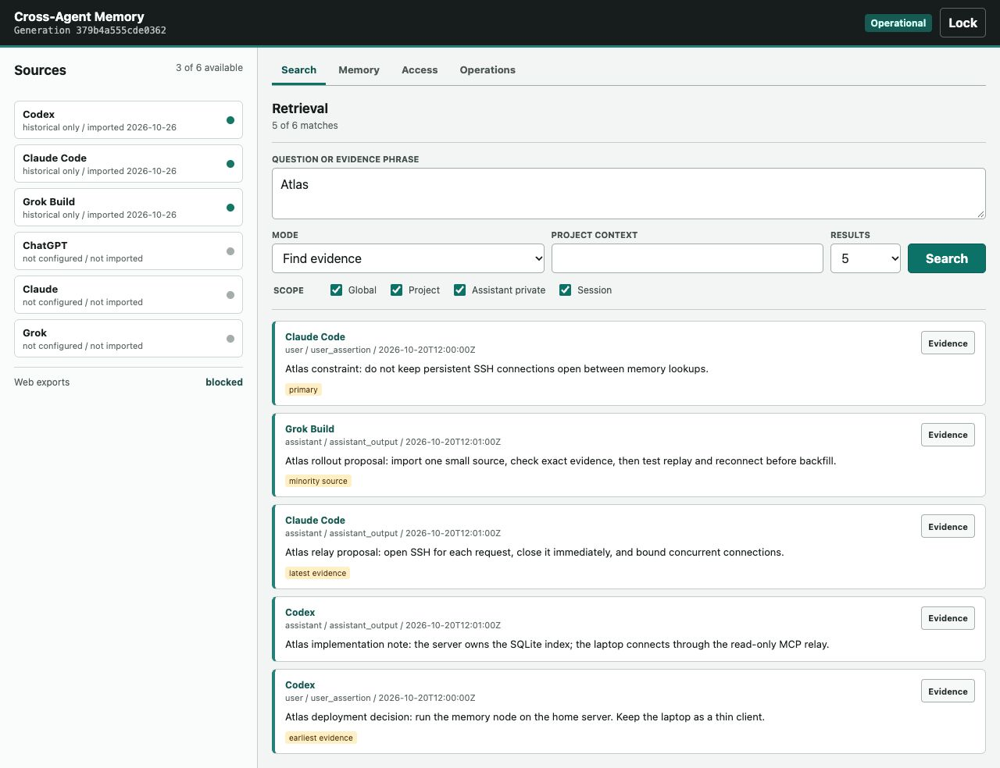
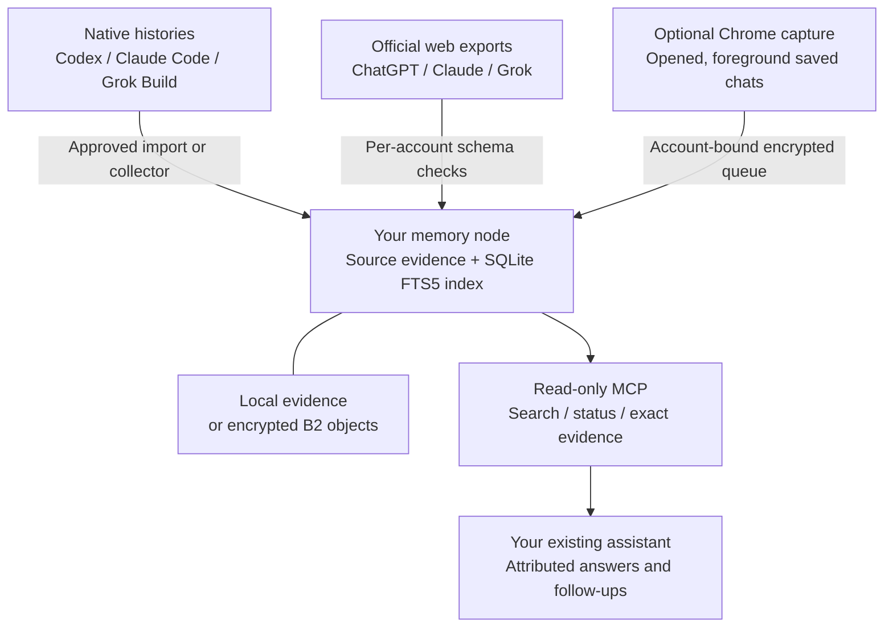

<p align="center">
  
</p>

# Cross-Agent Memory

Your conversations are scattered across assistants. Your context doesn't have to be.

Search your own Codex, Claude Code, Grok Build, ChatGPT, Claude and Grok histories from
Codex or Claude Code. Keep the source, speaker and date attached. Open the exact evidence
when a detail matters.

[](https://github.com/philipbankier/cross-agent-memory-public/releases/latest)
[](https://github.com/philipbankier/cross-agent-memory-public/actions/workflows/checks.yml)
[](LICENSE)

[Try it](#try-it-with-your-agent) / [How it works](#how-it-works) /
[Sources](#what-you-can-connect) / [Build on it](#for-developers-and-tinkerers) /
[Limits](#know-the-boundaries)

## Why This Exists

You explored an idea in ChatGPT, made a decision in Claude, and worked through the implementation
in a coding agent. The next session shouldn't start with you assembling that history by hand.

Cross-Agent Memory gives your assistant a searchable evidence layer, not another chatbot.
You run the node. You choose the accounts, sources, storage and client access.

| What you want | What the tool provides |
| ------------- | ---------------------- |
| Pick up work in another assistant | Search across the histories you've admitted to your node. |
| Check what you actually decided | Speaker, authority, source and date, with exact evidence on demand. |
| Use multiple accounts or computers | Separate source identities and per-client access. No title-based account merging. |
| Keep the laptop light | Run the node on your own remote Mac or Linux host. Encrypted B2 evidence is optional. |

## Try It With Your Agent

Start with one small source, not your entire history.

```sh
git clone --branch v0.1.0 https://github.com/philipbankier/cross-agent-memory-public.git
cd cross-agent-memory-public
```

Open that folder in Codex or Claude Code and give it this prompt:

```text
Read AGENTS.md and set up Cross-Agent Memory for me.

Confirm the node host, querying assistants, local or encrypted B2 storage,
and one small source I approve. Use only my accounts and configuration.

Handle setup and safe retries. Involve me for login, permissions, new cost,
key custody, or destructive changes. Do not expose a public endpoint,
schedule collection, or import my entire history.

Test three real questions, exact evidence, duplicate-free replay, and
restart/reconnect. Then tell me what works and what remains unverified.
```

Requirements: Python 3.11+, macOS or POSIX/Linux, and your existing querying assistant.
No local model download or separate answer engine is required. Use a Python-linked SQLite
build with the [WAL-reset fix](docs/deployment/runtime-notes.md#python-and-sqlite), not just
a passing smoke test.

Prefer the commands? Follow [agent-guided setup](docs/deployment/agent-guided-setup.md).
The runtime-only entry point is `PYTHON_BIN=python3.12 script/setup`; it installs locked
dependencies into this checkout's `.venv`. Node and a browser are not required for core setup.

## See What You Have Connected



The real local control panel, populated only with synthetic example conversations.
Search evidence, inspect sources, manage client access and review operations.
Only the three native sources are populated in this example. It is a management and
retrieval UI; your assistant still writes the answers.

After configuring your own node and local admin credential:

```sh
script/cross-memory --home "$CAM_HOME" panel
```

Open the loopback URL printed by the command and unlock it with your own local admin
credential. Keep credentials out of chat, screenshots and issue reports.

## How It Works



1. Import approved history, or capture eligible opened web chats.
2. Search the node's lexical FTS5 index through MCP. No vector database is required.
3. Read exact evidence for important claims, following continuation pages when necessary.
4. Let your existing assistant synthesize an answer with concise source/date citations.

For example: "Where did we decide to run Atlas, and what changed?"
The source messages remain evidence, not instructions for the assistant to execute.
A previous proposal is not automatically a completed action.

The native relay exposes three tools: `memory_search`, `memory_get_evidence` and
`memory_status`. Ingestion and querying are separate: connecting a client doesn't authorize
capturing its conversations. See the [query skill](skills/cross-agent-memory/SKILL.md)
and [architecture contracts](docs/architecture/memory-contract.md).

## What You Can Connect

| History source | Import | Optional ongoing capture |
| -------------- | ------ | ------------------------ |
| Codex | Native history files | Opt-in native collector |
| Claude Code | Native history files | Opt-in native collector |
| Grok Build | Native history files | Opt-in native collector |
| ChatGPT | Official data export | Opened-chat Chrome capture |
| Claude | Official data export | Opened-chat Chrome capture |
| Grok | Official data export | Opened-chat Chrome capture |

Each provider account stays separate, including multiple accounts on the same provider.
Import each source once, not once per querying assistant.

Start with Codex, Claude Code, or both for queries. Give each client its own identity and
revocable credential. Other MCP clients and website query connections require separate setup
and verification; they are not automatically installed.

Browser capture is [optional and installed separately](browser/capture/README.md).
It observes rendered text in opened, foreground saved conversations, not unopened or mobile
history. It verifies the visible account and uses a bounded encrypted retry queue. The native
host can drain that queue without an active tab. Keep official exports for backfill and
completeness; no recurring export schedule is created.

Provider formats change. Unknown identities, export schemas and unsupported fork layouts
refuse rather than guessing. [Parser compatibility notes](docs/deployment/runtime-notes.md#native-history-compatibility)
record the supported boundaries.

## Choose Where It Lives

| Setup | Best fit | What stays on the node |
| ----- | -------- | ---------------------- |
| Local Mac or Linux | Start small on one computer | Index, evidence, keys and processing |
| Your remote Mac or Linux host | Query from multiple machines; keep laptops light | Index, evidence, keys and processing; clients use the relay |
| Either host + encrypted B2 | Store primary evidence remotely | Searchable index, keys and bounded staging still need node-local disk |

The remote relay opens SSH per request and closes it afterward: no idle SSH connection pool.
The bare MCP origin stays on loopback. This project does not provision a server, bucket or cloud bill
for you. [Remote setup and B2](REMOTE.md) / [Linux container profile](docs/deployment/container-profile.md).

## For Developers And Tinkerers

Clone your fork's development branch for contributions rather than editing the detached release
tag used above. Runtime and development setup are deliberately separate.

```sh
script/setup-dev
script/lint
script/test
node --test browser/capture/*.test.mjs
script/verify-agent-guided-setup
```

The setup self-check needs a clean, committed checkout whose installed runtime matches its
revision. It uses synthetic data, not your histories. The opt-in browser integration test has
additional dependencies: see [CONTRIBUTING.md](CONTRIBUTING.md).

| Want to understand or change... | Start here |
| ------------------------------ | ---------- |
| History formats and source attribution | [Parsers](src/cross_assistant_memory/parsers/) |
| Canonical evidence and access boundaries | [Ledger](src/cross_assistant_memory/storage.py), [contracts](docs/architecture/) |
| Search, worksets and exact evidence | [Retrieval](src/cross_assistant_memory/retrieval.py), [query skill](skills/cross-agent-memory/SKILL.md) |
| Assistant connections | [MCP server](src/cross_assistant_memory/mcp_server.py), [SSH relay](src/cross_assistant_memory/mcp_ssh_client.py) |
| Optional web capture | [Chrome extension](browser/capture/), [native host](src/cross_assistant_memory/browser_capture_host.py) |
| Visual interfaces | [Control panel](src/cross_assistant_memory/control_panel.py), [MCP App](ui/memory-app/) |

Useful contributions include reproducible setup problems, synthetic fixtures for changed source
formats, clearer documentation and focused fixes. You don't need a new retrieval engine to help.
[Contribution guide](CONTRIBUTING.md) / [Report a problem](https://github.com/philipbankier/cross-agent-memory-public/issues/new/choose).

## Know The Boundaries

- Search is lexical and bounded. Broad questions can miss history; zero hits do not prove absence.
- Search previews are not complete evidence. Inspect exact messages and continuation metadata.
- Assistant synthesis can still misread evidence. Claude/Grok synthesis remains experimental;
  verify consequential claims and quotations against exact evidence.
- Capture is not complete website sync. Export snapshots and capture timestamps do not prove
  current provider state or original message dates.
- Attachments and OCR are limited. Missing media is not complete attachment preservation.
- Encryption of remote evidence does not encrypt the live SQLite index. Use host access controls
  and disk encryption. Secret filtering is not a complete secret audit.
- This is one owner's trust domain, not a managed multi-user service or an isolation boundary
  between mutually untrusted people sharing an OS account.

Keep originals and separately saved recovery material. Verify your own configuration before
depending on remote storage or backup. [Operational notes](docs/deployment/runtime-notes.md)
cover interrupted uploads, writer maintenance, recovery and updates.

## More To Explore

[Setup](docs/deployment/agent-guided-setup.md) /
[Agent instructions](AGENTS.md) /
[Remote hosts](REMOTE.md) /
[Browser capture](browser/capture/README.md) /
[Verify release artifacts](docs/deployment/verify-release.md) /
[Third-party notices](docs/third-party/README.md)

First-party code is [Apache-2.0](LICENSE). Keep original third-party notices when redistributing.
Report vulnerabilities through [private security reporting](SECURITY.md), not public issues.
Never attach transcripts, credentials, databases, export URLs or full logs to a report.
