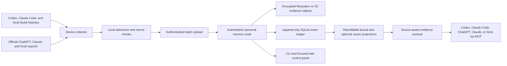

# ADR-0001: Canonical Evidence Ledger With Derived Memory Projections

Status: accepted v1 target; local baseline partially implemented; private pilot pending

Original decision: 2026-08-08

Last revised: 2026-08-27

Decision owner: Philip Bankier

Working name: Cross-Agent Memory

## Context

Useful decisions, preferences, tasks, source links, debugging history, and work state are
scattered across Codex, Claude Code, Grok Build, ChatGPT, Claude, and Grok. They may also be
split across multiple computers and provider accounts.

Native assistant memory is useful but cannot be the shared source of truth. Each provider has
different retention, editing, export, retrieval, and automation behavior. Assistant summaries
can misattribute suggestions to the user, preserve stale facts, or treat hostile imported text as
instructions.

The system must provide continuity without requiring assistants to share storage credentials,
turning every conversation into standing policy, or allowing lossy summaries to replace exact
recoverable evidence. It must work for people who run the node on a laptop, home server, NAS, or
VPS and who may use remote object storage because local disk is limited.

## Decision

Build a single-owner, self-hosted personal memory node. The node owns one canonical evidence
ledger, one writable SQLite database, and rebuildable search projections. Device-side collectors
admit and push source evidence to the node. Filesystem and S3-compatible object stores are the
supported evidence backends, with application-level encryption before remote upload.

The core is deterministic and usable without an LLM. Models may answer from retrieved worksets
or run optional enrichment jobs, but ingestion, admission, evidence recovery, search, backup,
restore, deletion, and policy enforcement do not depend on model access.

The architecture is not a single third-party memory framework. External memory systems may run
as replaceable projections or explicitly installed adapters against the same evidence contract.

## Product Boundary

V1 is a complete self-hosted product for one person, not a multi-tenant service.

- One installation has one owner and one authoritative writable node.
- The node may run locally, on a private home server or NAS, or on a VPS.
- Linux `amd64` and `arm64` OCI containers with Docker Compose are the primary node target.
- Native development mode remains supported.
- macOS and Linux collectors are first-party v1 targets. Windows is later work.
- Managed hosting may be offered later, but privacy, encryption, deletion, and portability remain
  part of the Apache-2.0 self-hosted core.

Replicated writable ledgers and multi-user household or team instances are outside v1.

## Storage And Recovery

SQLite is the only v1 ledger database. It lives with its WAL and shared-memory files on one
node-local persistent filesystem and has one serialized application writer. It is not placed on an
NFS, SMB, object-store, or other network filesystem. Search indexes and model-derived projections
are disposable and rebuildable.

Evidence objects use one storage contract with two backend families:

- Local filesystem
- S3-compatible object storage

V1 targets the local filesystem and Backblaze B2 S3 through the same application interface. AWS S3
and Cloudflare R2 are optional future claims, not v1 prerequisites. Compatibility is proven per
provider; one passing S3 implementation does not establish another provider's checksums, multipart
behavior, versioning, retention, or deletion semantics. A deterministic local fake supports fast
tests. Archived MinIO is not a release dependency or conformance proxy. A provider library passing
tests does not prove that ordinary ledger storage, hydration, or recovery uses that provider.

Remote objects are encrypted by the application before upload. Remote object keys are opaque and
random; source names, account identities, paths, and plaintext digests do not appear in them. The
storage provider sees ciphertext plus unavoidable size, count, timing, and access-pattern metadata.
The personal node holds operational keys and sees plaintext while processing and indexing admitted
evidence. The running node and its host are therefore trusted compute; this is not searchable
end-to-end encryption.

Setup generates an installation root key. Per-object data keys are wrapped by that root key. An
operational key may live in a platform secret store or mounted container secret, but first real
import requires a verified, provider-independent offline recovery kit. Keychain-only recovery is
not sufficient.

Tink Python `1.16.1` Streaming AEAD with `AES256_GCM_HKDF_1MB` is the provisional implementation
candidate. It is not frozen until macOS `arm64` and Linux `amd64` and `arm64` vectors, large-object
streaming, corruption and wrong-key failures, interruption, key rotation, rewrap, and offline
recovery pass. Libsodium secretstream remains the fallback. Custom cryptography is prohibited.
The local synthetic prototype has passed the listed behavior on macOS `arm64` only; provider,
cross-architecture, installation-wide rotation, and fresh-node recovery proof remain open.

The node can operate without a persistent hot cache and read primary objects directly. A later
optional hot cache must be explicitly bounded, hydrate and hash-verify objects on demand, and never
evict the only verified copy. Primary object storage is not itself a backup: recovery also requires
a consistent encrypted SQLite snapshot, manifests, configuration, and a provider-independent key
recovery path.

## Identity And Clients

Every device, provider account, source account, and client principal is registered explicitly
with an opaque identity. The owner deliberately links identities that belong to the same person;
the system does not infer identity from email addresses or display names.

An additional computer joins through agent-guided enrollment with a short-lived pairing code.
It receives a revocable device credential and never sends provider login credentials to the
node.

Clients receive separate least-privilege credentials:

- Collectors may upload only for their registered device and source accounts.
- Assistant clients may search, read evidence, and propose candidates.
- The scheduler may stage, verify, and prepare imports but may not curate memory.
- Local administration may approve, correct, delete, manage keys, and revoke clients.

Device collectors push over authenticated HTTPS. The node does not require broad SSH or remote
filesystem access to source computers.

Supported connection profiles are loopback, private LAN or overlay network such as Tailscale or
WireGuard, and public HTTPS behind OAuth or OIDC. No direct unauthenticated public origin is
supported. Cloudflare Tunnel may be a documented profile but is not a product dependency.

## Ingestion

First-party v1 sources are:

- Native Codex histories
- Native Claude Code histories
- Native Grok Build histories
- Official ChatGPT exports
- Official Claude exports
- Official Grok exports

Collectors perform deterministic admission before content leaves the source device. They upload
exact admitted bytes plus source identity, hashes, locators, and text-free exclusion receipts.
Private, `no-memory`, synthetic, and high-confidence secret-bearing records do not leave the
source device.

High-confidence secrets such as private keys and recognized API token formats fail closed into a
local quarantine. Lower-confidence detections are flagged for review. A user may exclude, redact,
or narrowly approve a false positive. Canonical evidence is never silently changed.

The sync model has two speeds:

- Explicit MCP capture may immediately propose an important decision, correction, or task.
- Native history and official export reconciliation later supplies canonical evidence.

Local collectors target a 15-minute cadence while their device is active and provide `sync now`.
ChatGPT, Claude, and Grok web histories use a weekly assisted export workflow. Weekly is the
request cadence, not a freshness guarantee: provider preparation and expiring download links may
require later human action. The workflow may request, monitor, download, verify, and stage an
export, but it pauses for login, CAPTCHA, 2FA, approval, expired links, or provider UI changes.
Fully unattended browser automation and private web API scraping are off by default.

When the node is unavailable, a collector keeps a bounded encrypted local queue and retries with
backoff. Queue age and size are configurable and visible. Expired entries can be rediscovered
from canonical source history during reconciliation.

Unknown source schemas fail closed into encrypted staging. First-party connectors record the
source client and version, capture capability, adapter version, and schema fingerprint. They use
versioned validation and fixtures for every supported release and do not partially ingest
structures they no longer understand. Native local files may provide higher fidelity, but they are
not treated as permanent public interchange contracts.

## Canonical Layers

### Layer 0: Source objects

- Preserve exact admitted native or exported source bytes.
- Preserve attachment identity, type, size, digest, and conversation linkage.
- Encrypt before remote upload. Assign every new source object and every storage object an opaque
  random identifier. Preserve existing internal source IDs through an explicit legacy mapping, but
  never reuse a digest-derived legacy ID as a remote key.
- Record plaintext and ciphertext digests in authenticated local manifests rather than remote key
  names. ETags are not integrity identifiers.
- Record source client, client version, capture capability, adapter, parser, schema fingerprint,
  media type, capture time, and supersession metadata.
- Represent exclusions with text-free receipts, never persisted excluded plaintext.
- Keep source evidence recoverable without its search projection.

### Layer 1: Normalized event ledger

- Store append-only messages, observations, decisions, tasks, corrections, status changes, and
  artifact references.
- Preserve speaker role, provider, account, device, conversation branch, timestamps, and exact
  source locator.
- Represent correction, redaction, deletion, and supersession as linked mutations rather than
  silent replacement.

### Layer 2: Access And Context

Access control and organization are independent.

- Every record has an access classification enforced before ranking.
- Every record may have zero or more optional contexts.
- Context kinds may include project, topic, person or relationship, life area, and custom.
- Unlabelled evidence remains searchable in the owner's general corpus.
- Inferred contexts may improve retrieval but may not broaden access or authority.

`project` is one context type, not a required container for personal memory.

### Layer 3: Derived Projections

- Build disposable lexical, semantic, current-state, task, preference, and context projections.
- SQLite FTS remains the always-available retrieval baseline.
- Optional local embeddings may be selected after a resource-bounded bakeoff. External embedding
  providers require explicit opt-in and disclosure that content leaves the node.
- Store the exact model artifact revision and digest, license, runtime, dimensions, preprocessing,
  and projection version needed to rebuild each semantic projection.
- Do not enable model-specific remote code during installation or inference.
- Continuous LLM processing of every conversation is prohibited by default.

### Layer 4: Query Worksets

Retrieval is intent-triggered, with explicit force and suppress controls. Memory is not injected
into every prompt.

The node returns structured evidence worksets rather than generating the final answer. The caller
assistant synthesizes the response. Workset construction uses lexical and optional semantic
candidates, then applies access, context, authority, time, conflict, and token-budget rules.

The final workset is source-aware rather than one global top-k or equal provider quotas. It should
preserve earliest mentions, later corrections, current conclusions, contradictions, and useful
minority-source evidence.

Normal answers show subtle, concise citations. Exact excerpts, provenance, conflicts, source
objects, and whether text came from the user or an assistant remain available on demand.

## Attachments And Enrichment

V1 preserves and cites admitted attachments. Deterministic extraction is supported for bounded,
straightforward formats such as plain text and PDFs. Large objects are hydrated on demand and
subject to configurable type and size limits.

OCR, audio transcription, image captioning, and model-based analysis are optional enrichment
jobs. When enabled, derived output remains labeled, versioned, and linked to the original object.
Attachment ingestion still succeeds when no capable model is configured.

## Interfaces

V1 intentionally has a small external surface:

- One authenticated batch-upload endpoint for collectors
- MCP tools for search, evidence recovery, and inactive proposals
- Basic health and device enrollment operations
- A CLI and responsive web control panel that call the same application functions

There is no broad public REST API, GraphQL API, or generated SDK suite in v1.

MCP support is accepted per client and transport, not as one generic claim. Local stdio, local
Streamable HTTP, and remote OAuth-fronted Streamable HTTP have separate acceptance tests. Web
assistants originate remote connections and do not inherit local Codex or Claude Desktop MCP
configuration. Local HTTP remains authenticated; binding to localhost is containment, not
authorization.

The web control panel covers onboarding and recovery, source status, assisted exports, search and
evidence inspection, contexts, candidates, correction and deletion, storage, and backup status.
The CLI remains the automation and debugging contract.

## Authority And Approval

Every record carries provenance and authority. Provenance answers where text came from. Authority
answers what that source may establish. Confidence and repetition never increase authority.

Ordinary admitted evidence becomes searchable without per-conversation review. Explicit approval
is required only for actions that change durable authority or control:

- A standing global preference or instruction
- Selecting current truth across material conflicting evidence
- An ongoing automation or policy
- Broader access
- Redaction or deletion

A direct, bounded `remember this as ...` request may itself provide the required approval.
Assistant-generated procedures and preferences otherwise remain inactive candidates.

## Deletion, Backup, And Portability

Practical deletion supports pre-import exclusion and removal by conversation or source account.
Deletion removes searchable records, FTS and optional semantic projections, caches, hydrated
files, remote objects, attachments, and derived outputs, then retains a text-free tombstone to
prevent reimport. SQLite `secure_delete` alone is not proof because FTS shadow tables and old
snapshots may retain content. The deletion procedure rebuilds affected projections, vacuums or
replaces the database, verifies retrieval and exact-evidence paths, and reports any surviving
backup or cloud version. Message-level redaction may be added only where the source format can
support it without ambiguous evidence claims.

The product states the actual backup-retention limit and does not claim enterprise compliance.

Backup and recovery remain simple:

- `backup` uses SQLite's online backup API to create one consistent encrypted snapshot and uploads
  it when configured.
- `restore --verify` restores into a new location and verifies manifests, hashes, objects, and
  schema.
- Optional scheduling is configured in one command.
- The UI reports the last successful backup and last verified restore.

The default portable export is a provider-neutral encrypted bundle containing admitted evidence,
normalized events, provenance, contexts, candidates, approvals, corrections, tombstones, and
source identity mappings without credentials. Search indexes are rebuilt. Plaintext export is an
explicit high-risk operation.

## Community Adapters And Telemetry

Community adapters are explicitly installed out-of-process and receive only the selected source
or export. They declare filesystem and network capabilities. The core reapplies schema,
admission, authority, and access validation and does not give adapters database, encryption-key,
or storage credentials. This is containment, not a claim of a perfect sandbox.

Telemetry is off by default. Optional diagnostics may include coarse version, platform,
connector, error category, latency, and success data. They never include content, queries, paths,
account identifiers, or credentials.

## V1 Release Boundary

V1 includes the single-owner node, macOS and Linux collectors for the three native sources, the
three official web export importers, assisted weekly export handling, encrypted filesystem or
tested provider-profile storage, SQLite and FTS retrieval with optional local embeddings, MCP,
CLI, focused web UI, backup and verified restore, portable encrypted export, and agent-first setup
for Codex and Claude Code.

V1 excludes managed hosting, Windows collectors, autonomous browser exports, continuous LLM
enrichment, multi-user operation, replicated writers, Kubernetes-first deployment, and a broad
public API.

## Proof And Release Sequence

The existing repository proves a bounded local evidence ledger, six parsers, guarded import
planning, exact evidence recovery, MCP retrieval, and private backup exercises. It does not prove
the full product described above.

The release sequence is:

1. Make Philip's complete private deployment work smoothly as the reference implementation.
2. Verify all six sources, natural cross-source queries, scheduled sync, assisted export refresh,
   offline recovery, backup, and restore without manual database repair.
3. Prove the frozen encryption envelope, provider profiles, archive budgets, MCP client matrix,
   deletion procedure, and fresh-host restore path.
4. Convert those workflows into a small synthetic end-to-end acceptance suite on clean macOS and
   Linux environments.
5. Audit the repository tree and Git history before publication and add licensing, security,
   reproducible builds, dependency provenance, SBOM, and release attestations.
6. Publish only text-free aggregate pilot metrics, architecture diagrams, and manually reviewed
   lessons.

Public tests and examples use synthetic fixtures. Real transcripts never become repository test
data.

## Alternatives Rejected

### One vendor's native memory as canonical

Rejected because it cannot provide cross-provider evidence, stable exports, uniform authority,
or independent recovery.

### One open-source memory framework as the whole system

Rejected because current projects make different tradeoffs around raw retention, promotion,
organization, retrieval, graph complexity, and security. They are more useful as projections and
adapters.

### Browser scraping as primary ingestion

Rejected because private APIs and DOMs change, broad extension permissions increase risk, and
provider terms may prohibit automated access.

### Bidirectional synchronization of native memories

Rejected because it creates feedback loops, duplicate facts, authority escalation, and difficult
deletion semantics.

### Vector database as source of truth

Rejected because embeddings are a search aid, not recoverable evidence or an audit log.

### Multi-tenant or replicated-writer v1

Rejected because it adds identity, isolation, conflict, and operational complexity before the
single-owner workflow is proven.

## Consequences

Positive consequences:

- Retrieval, embeddings, and assistant clients can change without migrating the evidence archive.
- Conflicting memories and stale facts remain inspectable.
- Different clients receive narrow, revocable capabilities.
- Users with limited local disk can retain encrypted evidence remotely.
- The same agent-guided setup supports Philip's private deployment and later self-hosted users.

Costs and constraints:

- The authoritative node is an availability dependency for live queries.
- Connectors require maintenance as upstream schemas change.
- Application-level encryption and recovery-key handling add setup responsibility.
- User approval adds deliberate friction where actions change authority, access, or retained data.

## Superseded Assumptions

This revision supersedes the earlier requirements that every installation use `mac-mini`,
Backblaze B2, Cloudflare Tunnel, a project-only organization model, or Keychain-only recovery.
Those remain valid private deployment choices or historical evidence, not product dependencies.

The dated assumptions and evidence behind this revision are recorded in the
[2026-08-27 specification audit](../research/spec-audit-2026-08-27.md). Implementation order and
proof gates are defined in [the private-pilot v1 plan](../implementation/private-pilot-v1-plan.md).
